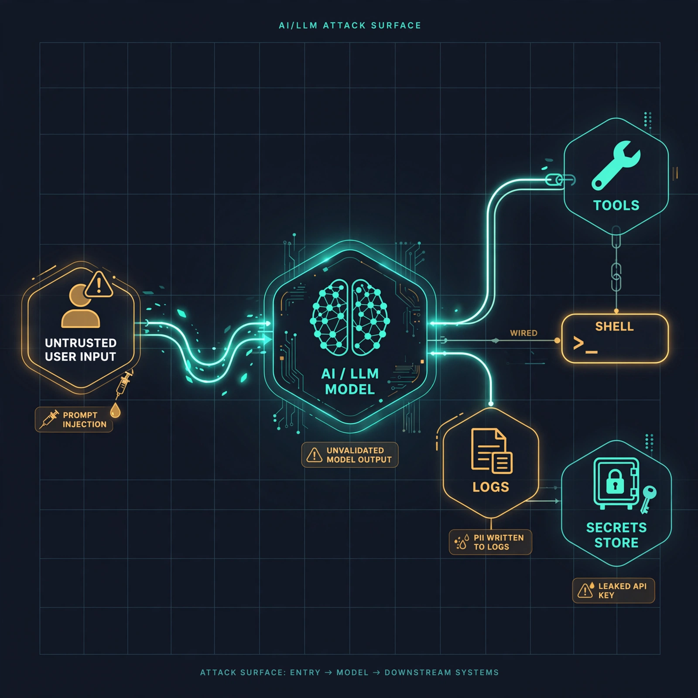

# canary-agent

**An AI triage-and-fix agent for LLM application security.** Built for the
Meta Global AI Developer Hackathon (Oct 27 - Nov 4, 2026), Indie track.



AI agents now write a growing share of production code, and they introduce
exactly the failure modes classic tools miss: prompt injection, excessive
agency, leaked keys, unvalidated model output. `canary-agent` reads those
findings, uses **Muse Spark** to decide which are real and why, writes a fix,
and proves the fix works by re-running the scanner. The model proposes; the
deterministic scanner disposes.

## What is new here, and what is not

> **Disclosure (Indie track, "new work only").** The detection engine is
> [**canary**](https://github.com/jcedrik/canary) (`canary-sast` on PyPI, MIT),
> written and published *before* the hackathon. It is used here as an
> off-the-shelf input: `canary-agent` consumes canary's JSON findings. **Every
> line in this repository is new work built during the hackathon:** the Muse
> Spark triage, the fix-and-verify loop, the evaluation against expert labels,
> and the Muse Code MCP server. The demo video shows only this new layer.

## The agent

```
canary findings ──► triage (Muse Spark) ──► fix (Muse Spark) ──► re-scan (canary)
                      true/false positive      patch on a           verified?
                      + reason                 scratch copy          keep / retry
```

1. **Triage.** For each finding, Muse Spark reads the code window and returns a
   structured verdict: true positive or false positive, a confidence, and a
   reason. (`canary_agent/triage.py`)
2. **Fix and verify.** For a confirmed finding, the model writes a patch,
   canary re-scans, and the patch is kept only if the finding is gone and no
   new one appears. (`canary_agent/loop.py`, in progress)
3. **Scan-as-you-code.** An MCP server exposes the scanner to Muse Code, so the
   coding agent checks a block *before it saves it*. (`canary_agent/mcp_server.py`)

## Scan-as-you-code with Muse Code

Install the MCP extra and register the server with your coding agent:

```bash
pip install -e .[mcp]
```

Muse Code / Claude Code / any MCP client, in its MCP config:

```json
{
  "mcpServers": {
    "canary-agent": { "command": "canary-agent-mcp" }
  }
}
```

The server exposes three tools: `scan_snippet` (check code before saving it),
`scan_path` (scan a file or dir), and `triage_path` (scan + Muse Spark verdict).
The demo flow: Muse Code writes an agent tool that pipes model input to a shell,
calls `scan_snippet`, gets CANARY-EA-001 back, and rewrites it, all before the
file lands on disk.

## Why this is measurable, not a vibe

The scanner's benchmark already carries **77 findings hand-reviewed TP/FP** by
the author. The eval harness runs the triage agent over those same findings and
reports how often it agrees with expert review, and how much precision improves
if you keep only what the agent calls a true positive.

```bash
# offline, no API key, no spend (mock backend, for building the pipeline):
CANARY_AGENT_MOCK=1 python eval/run_eval.py

# live, once credits are applied:
export MODEL_API_KEY=...          # never commit this
python eval/run_eval.py --rule CANARY-PI-001
```

The mock backend exists only so the pipeline can be built before credits land;
its numbers are labelled MOCK and mean nothing. Real numbers come from the live
run.

**Live result (muse-spark-1.3, 77 findings):** 90% agreement with expert labels,
95% precision, 89% recall, F1 92%. On the high-signal rules you gate a build on
(prompt injection, PII), **97% precision / 91% recall**. Each confirmed finding
is ranked by exploitability (reaches a tool/shell, a secret, or only its own
output), and the agent caught false positives in the benchmark's own labels,
verified against the source. Full methodology and numbers in
[`eval/EVAL.md`](eval/EVAL.md).

## Quickstart

```bash
pip install -e .
canary ./some-llm-app --format json -o findings.json   # from canary-sast
MODEL_API_KEY=... canary-agent findings.json            # triage them
```

Configuration is read from the environment, so no secret touches the code:

| Variable | Default | Meaning |
|---|---|---|
| `MODEL_API_KEY` | (none) | Meta Model API key. Absent means mock mode. |
| `CANARY_AGENT_MODEL` | `muse-spark-1.3` | model id |
| `CANARY_AGENT_MOCK` | off | set `1` to force offline mock |

## Tested on real-world projects

Beyond the 10-repo benchmark, canary was run on fresh, popular LLM/agent
projects. These are raw scanner findings that the triage agent then ranks, not
confirmed vulnerabilities; the "injection candidates" column is PI-001/PI-002,
the high-signal rules you gate on.

| Project | Files | Findings | Injection candidates |
|---|---:|---:|---:|
| microsoft/autogen | 616 | 31 | 11 |
| crewAIInc/crewAI | 982 | 35 | 10 |
| langflow-ai/langflow | 4,400 | 30 | 7 |
| assafelovic/gpt-researcher | 351 | 20 | 7 |
| FlowiseAI/Flowise | 522 | 37 | 3 |
| stanford-oval/storm | 53 | 7 | 2 |

## Standards

Every finding carries its OWASP LLM Top 10 (2025) category (from canary) and,
where it maps cleanly, its OWASP Top 10 for Agentic Applications (2026) class:
ASI-01 Agent Goal Hijack (prompt injection), ASI-02 Tool Misuse (a tool wired to
a shell), ASI-03 Identity & Privilege Abuse (a leaked key).

## Status

- [x] Triage with exploitability ranking, measured against 77 expert labels
- [x] Fix-and-verify loop (patch -> canary re-scan -> accept only if cleared)
- [x] Agentic context lookups across files when a snippet is ambiguous
- [x] MCP server for Muse Code (scan-as-you-code)
- [x] Muse Image attack-surface visualization
- [x] Offline mock mode + tests (no key needed)

## Roadmap

- Cross-function / cross-file taint tracking (the agent fetches context today;
  full dataflow is next)
- MCP configuration auditing: unpinned servers, over-broad permissions, tool
  shadowing - canary-agent is itself an MCP server
- More rule families and languages
- A larger, multi-reviewer evaluation set
- Validation on real bug-bounty / disclosure targets

## License

MIT.
